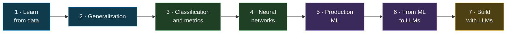
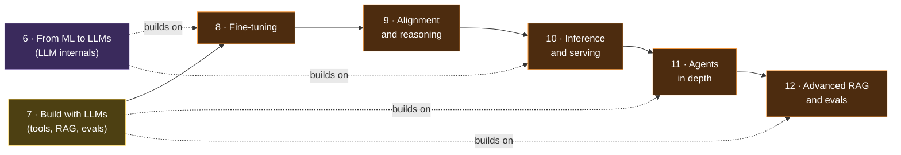
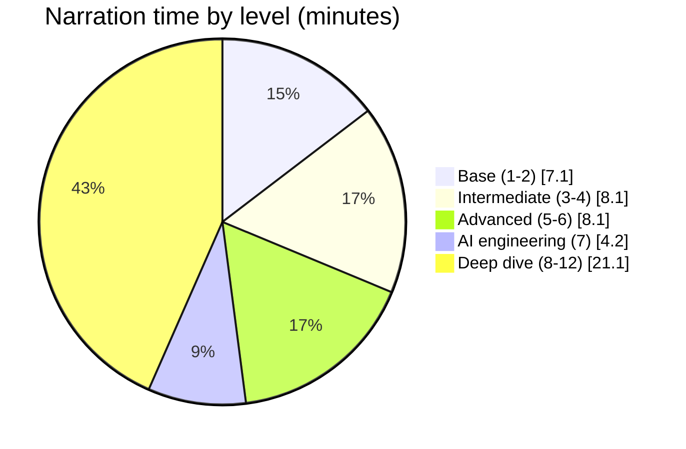
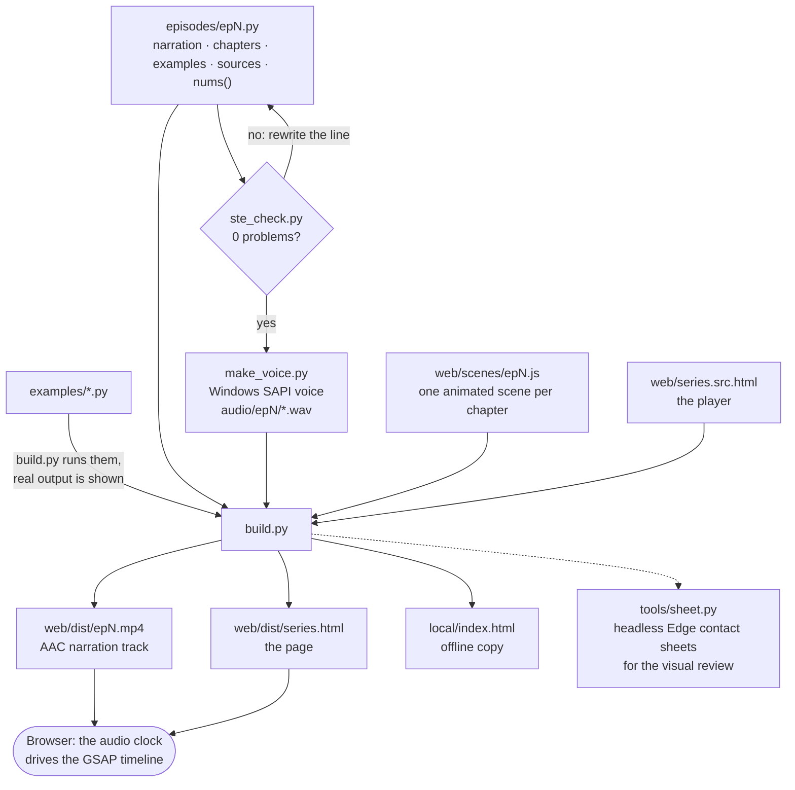

# ML to AI Engineering: a narrated, animated series

Twelve short video-style lessons that take you from **a line fitted to 24 houses** to **agents, fast inference and advanced RAG**.
Each episode is an animated, narrated web page in the style of 3Blue1Brown, with runnable Python code and the real output of that code on screen.
The narration is written in Simplified Technical English (ASD-STE100 style) so that it is easy to follow, also for readers whose first language is not English.

| | |
|---|---|
| **Episodes** | 12: a 7-episode core course and 5 "deep dive" episodes |
| **Narration** | about 49 minutes, 353 lines, one synthetic voice (Windows SAPI, "Microsoft David Desktop") |
| **Code** | 37 Python files; 35 run during the build and their real output is shown, 2 need an API key |
| **Stack** | Python (NumPy, scikit-learn, SciPy, PyAV, FastAPI) to build; SVG + [GSAP](https://gsap.com) in the browser to play |

## Contents

| Section | What you find there |
|---|---|
| [Watch it](#watch-it) | Open the series in your browser in one step, and how the player works |
| [The learning path](#the-learning-path) | A graph of the 12 episodes and what builds on what |
| [Episodes at a glance](#episodes-at-a-glance) | A table of every episode: level, scenes, runnable examples, length |
| [What each episode teaches](#what-each-episode-teaches) | A short description of each episode |
| [A taste of the examples](#a-taste-of-the-examples) | Real numbers that the code in episode 12 prints |
| [How it works](#how-it-works) | The build pipeline (graph) and the contract that every episode follows |
| [Writing rules (STE100)](#writing-rules-ste100) | The rules for the narration and the script that checks them |
| [Requirements](#requirements) | What you need to play, run and build |
| [Build and run](#build-and-run) | The commands |
| [Repository layout](#repository-layout) | Every folder with a one-line description |
| [What is real and what is a stand-in](#what-is-real-and-what-is-a-stand-in) | Honest notes about toys, scripted models and limits |
| [Add an episode](#add-an-episode) | A checklist |
| [Sources and credits](#sources-and-credits) | Where the content comes from |

## Watch it

Open **[`series/local/index.html`](series/local/index.html)** in a browser (tested in Microsoft Edge).
It is a complete offline copy: the page, the 12 narration tracks and the animation library are in the same folder.
Without internet the web fonts fall back to system fonts.

`series/web/dist/series.html` is the same page for web hosting. It expects the `epN.mp4` files next to it and loads GSAP from a CDN.

**Player**

- Pick an episode in the strip at the top. Click a chapter to jump to it.
- `Space` plays or pauses. `←` and `→` move 5 seconds. A button turns the subtitles on or off, and another goes to full screen.
- Under the stage you find the **code for the episode** with its real output, the **transcript**, and the **sources**.
- If the narration audio does not load, the animation still plays with subtitles only.

## The learning path

**Core course.** Watch in order; each episode uses the one before it.



**Deep dives.** Watch in order 8 to 12. Dotted arrows show the main idea from the core course that a deep dive builds on.



Runtime by level, in minutes:



## Episodes at a glance

| # | Level | Episode | Scenes (one per chapter) | Examples you can run | Length |
|--:|---|---|---|---|---|
| 1 | Base | **Learn from data** | rules or examples · a model is a function · loss · gradient descent · learning rate | gradient descent from scratch (NumPy) · the same fit with scikit-learn | 3:07 |
| 2 | Base | **Generalization** | train, validation, test · underfitting and overfitting · model complexity · regularization · cross-validation | train and validation error for each polynomial degree · Ridge penalty chosen by 5-fold cross-validation | 4:00 |
| 3 | Intermediate | **Classification and metrics** | number or class · logistic regression · threshold · confusion matrix · trees and ensembles | logistic regression and its metrics · gradient boosting against logistic regression | 4:06 |
| 4 | Intermediate | **Neural networks** | a neuron · layers · why the activation matters · backpropagation · training | a neural network from scratch (NumPy) · the same task with scikit-learn | 4:01 |
| 5 | Advanced | **Production ML** | the model lifecycle · one pipeline · serve predictions · watch for drift · versions and tests | one pipeline saved as one file · serve it with FastAPI · detect drift, retrain and compare | 4:07 |
| 6 | Advanced | **From ML to LLMs** | tokens · embeddings · attention · next-token prediction · training an LLM | attention from scratch · a character bigram model and temperature | 3:59 |
| 7 | AI engineering | **Build with LLMs** | one API call · the prompt · RAG · tools and agents · evals | RAG retrieval with TF-IDF · an eval harness · *two Claude API examples (need a key, not run)* | 4:10 |
| 8 | Deep dive | **Fine-tuning** | why fine-tune? · supervised fine-tuning · LoRA · QLoRA · prompt, RAG or fine-tune? | LoRA against full fine-tuning on a toy model · memory for a 7B model: full, LoRA, QLoRA | 4:14 |
| 9 | Deep dive | **Alignment and reasoning** | beyond imitation · the reward model · RLHF with PPO · verifiable rewards · GRPO | a reward model from pairs · the KL penalty and the PPO clip · a verifiable reward · GRPO on a toy policy | 4:02 |
| 10 | Deep dive | **Inference and serving** | prefill and decode · the KV cache · batching and paged memory · faster decoding · cache and route | decode with and without a KV cache · batching and paged memory · speculative decoding and quantization · prompt caching and routing | 4:10 |
| 11 | Deep dive | **Agents in depth** | the agent loop · planning · context engineering · memory · many agents | a ReAct loop · plan, run, re-plan · short-term and long-term memory · an orchestrator and two workers | 4:13 |
| 12 | Deep dive | **Advanced RAG and evals** | where basic RAG fails · chunks · hybrid search · reranker · evals for RAG | a small corpus · TF-IDF, BM25, dense, fusion and a reranker · chunking · hybrid search · two-stage search · RAG evals | 4:30 |

## What each episode teaches

**Core course**

1. **Learn from data.** A program that learns from examples, not from rules. A model is a function with numbers you can change. The loss tells how wrong it is, and gradient descent makes it less wrong, one step at a time. The learning rate sets the size of the step.
2. **Generalization.** A model that is good on old data can be bad on new data. Split your data into train, validation and test sets, see underfitting and overfitting as model complexity grows, and fix it with regularization and cross-validation.
3. **Classification and metrics.** Predict a class, not a number: logistic regression, the sigmoid and the threshold. Judge the result with the confusion matrix and its metrics. Then see decision trees and ensembles of trees.
4. **Neural networks.** A neuron, layers of neurons, and why the activation function matters. Backpropagation computes the gradient for every weight, and training repeats the steps. You write the network in NumPy before you use a library.
5. **Production ML.** Move a model out of a notebook: the model lifecycle, one pipeline saved as one file, a web endpoint that serves predictions, drift monitoring, and versions and tests.
6. **From ML to LLMs.** Tokens, embeddings, attention and next-token prediction, and how an LLM is trained. You compute attention yourself and sample from a tiny language model.
7. **Build with LLMs.** AI engineering: call a model API, write a good prompt, add your own data with RAG, let the model use tools (an agent), and measure every change with evals.

**Deep dives**

8. **Fine-tuning.** When to change the weights and when not to. Supervised fine-tuning, LoRA (train a small low-rank update), QLoRA (the same on a 4-bit base model), and a clear choice between prompting, RAG and fine-tuning.
9. **Alignment and reasoning.** Go beyond imitation: a reward model learned from human preferences, RLHF with PPO and its KL penalty, rewards that a rule can check, and GRPO, the method behind many reasoning models.
10. **Inference and serving.** Why generation is slow and how to make it fast: prefill and decode, the KV cache, continuous batching and paged memory, speculative decoding, quantization, caching and routing. Costs are computed from stated configurations.
11. **Agents in depth.** The ReAct loop, plans that can be repaired, context engineering, short-term and long-term memory, and teams of agents with an orchestrator. The models in the examples are scripted stand-ins; the tools are real.
12. **Advanced RAG and evals.** Where basic RAG fails and how to fix it: how you split the text, hybrid search (BM25 + dense + reciprocal rank fusion), a reranker, and how to measure the search and the answer separately. It ends the series with a wrap-up and a task for you.

## A taste of the examples

Every number on screen comes from running the code in [`series/examples/`](series/examples/). For example, episode 12 compares six versions of a retrieval pipeline on 21 test questions over a 42-paragraph bike-shop handbook:

| Version | recall@3 (right chunk in the top 3) | MRR (mean of 1 ÷ rank) |
|---|--:|--:|
| TF-IDF (episode 7) | 17 / 21 | 0.731 |
| BM25 | 19 / 21 | 0.802 |
| Dense stand-in (LSA) | 18 / 21 | 0.744 |
| Hybrid (BM25 + dense, RRF) | 19 / 21 | 0.742 |
| Hybrid + reranker (top 10) | 20 / 21 | 0.792 |
| BM25 + section title line | 20 / 21 | **0.867** |

The episode says plainly what this does and does not show: hybrid search does **not** beat plain BM25 on MRR here, one question is worth 4.8 points, and the result holds for this small corpus only.

## How it works

One Python module per episode is the single source of truth. The scene code, the audio and the page are all built from it.



**The audio is the clock.** Each narration line is one WAV file. The build joins the lines into one AAC track per episode and records the start time and length of every line.
In a scene, you place each animation relative to a line, for example `at("c3", 0.5)` (half a second into line `c3`) or `frac("c3", 0.4)` (40 % through it). If you change the narration, the animation follows.

**Nothing on screen is typed by hand.** Numbers come from `nums()` in the episode module, and from the real output of the examples. In the newer episodes (8 to 12 most of all), the module also `assert`s the claims that the narration makes, so the build stops if the narration and the numbers disagree.

**The episode contract**

| Item in `episodes/epN.py` | Meaning |
|---|---|
| `EPISODE` | id, number, level, title, blurb |
| `CHAPTERS` | list of `(chapter_id, title)`; each chapter is one scene |
| `SEGMENTS` | list of `(chapter_id, key, text)`; one narration line each, and `audio/epN/<key>.wav` |
| `EXAMPLES` | files in `examples/`; with `ran: True` the build runs them and shows the real stdout |
| `SOURCES` | papers and docs that the episode uses |
| `SPOKEN` (optional) | replacements for the voice only, for example `BM25 → "B M 25"`; the subtitles keep the written form |
| `nums()` (optional) | every number that the scenes show |

The scenes live in `web/scenes/epN.js` as `SCENES_BY_EP.epN = { chapter_id(sc, N) { ... } }`. The full contract and the status of each episode are in [`series/OUTLINE.md`](series/OUTLINE.md).

## Writing rules (STE100)

| Rule | Limit |
|---|---|
| Words in one sentence | 20 at most |
| Sentences in one narration line | 6 at most |
| Contractions | none |
| Words that end in *-ing* | only inside a technical name (for example "machine learning", "fine-tuning") |
| Passive voice | flagged for review |

`series/ste_check.py` measures these rules, and every episode must pass with **0 problems**. It does **not** check words against the licensed ASD-STE100 dictionary, so the text follows the style but is not a certified STE document.

## Requirements

| To do this | You need |
|---|---|
| Watch the series | A modern browser. Open `series/local/index.html` |
| Run an example | Python 3.12 with `numpy`, `scikit-learn`, `scipy`; episode 5 also `fastapi`, `httpx`, `joblib`, `pydantic` |
| Run the two Claude API examples of episode 7 | the `anthropic` package and an Anthropic API key |
| Build the page and the audio tracks | all of the above, `av` (PyAV), and **Windows** for the voice (`System.Speech` through PowerShell) |
| Make review contact sheets | Microsoft Edge (headless) |

Tested with Python 3.12.12, numpy 2.5.5, scikit-learn 1.9.1, scipy 1.18.1, av 19.0.2, fastapi 0.165.0, httpx 0.28.1, joblib 1.6.0 and pydantic 2.14.4. There is no `requirements.txt` yet.

```
python -m venv .venv
.venv\Scripts\activate
pip install numpy scikit-learn scipy av fastapi httpx joblib pydantic
```

## Build and run

Run these from the `series/` folder.

```
python examples/ep12_rag_eval.py       # run any example on its own
python ste_check.py ep12               # check the narration rules (0 problems required)
python make_voice.py ep12              # record the voice (only changed lines are made again)
python build.py --eps ep12             # test build of one episode -> web/dist/test-ep12.html
python tools/sheet.py ep12             # contact sheets for the visual check -> build/sheets/
python build.py --release ep1 ep2 ep3 ep4 ep5 ep6 ep7 ep8 ep9 ep10 ep11 ep12
                                       # final pages + 12 mp4 files + the offline copy in local/
```

The `audio/` folders (about 250 MB of WAV files) are **not** in the repository. `make_voice.py` makes them again on Windows. The finished narration is already inside the `.mp4` files.

## Repository layout

```
llm-explainer-video/
├── README.md
├── series/                      the 12-episode series
│   ├── OUTLINE.md               outline, episode contract, status, known flaws
│   ├── episodes/                one module per episode: narration, chapters, examples, sources, nums()
│   ├── examples/                37 runnable Python files that the pages show
│   ├── web/
│   │   ├── series.src.html      the player: picker, stage, subtitles, code, transcript, sources
│   │   ├── scenes/              one JavaScript file per episode: animated SVG scenes
│   │   └── dist/                built page and one narration track (.mp4) per episode
│   ├── local/                   offline copy: index.html, 12 mp4 files, GSAP
│   ├── research/                notes used as a topic map for episodes 8 to 12
│   ├── tools/sheet.py           contact sheets from headless Edge
│   ├── build.py                 builds the audio tracks and the page
│   ├── make_voice.py            makes one WAV per narration line (Windows SAPI)
│   ├── ste_check.py             checks the STE100 rules
│   └── common.py                the list of episodes and the voice replacements
├── web/, narration.py,          the first explainer in this repository:
│   build_web.py, make_voice.py,  "Mixture of Experts vs omni-modal" (one video page).
│   ste_check.py                  The series player is a copy-and-extend of its page.
└── .gitignore                   keeps the venv, caches, build files and audio WAV files out
```

## What is real and what is a stand-in

The series says this on screen, and this list repeats it:

- **Toy models are labelled as toys.** The LoRA, reward-model, GRPO and similar examples use small NumPy models so that you can read all of the code. They show the mechanism, not the scale.
- **Scripted models in agent examples.** In episode 11 the "model" is a stand-in with fixed rules, so that the file runs offline. The tools (a lookup and a calculator) run for real. Replace the stand-in with one LLM call to use a real model.
- **Dense search, reranker and judge in episode 12.** The dense search is latent semantic analysis (a real SVD method, but **not** an embedding model). The reranker counts shared words (**not** a neural cross-encoder). The judge is a toy that is built with a bias, to show the swap test.
- **Illustrations are labelled.** A few scenes are drawings of an idea, not measurements, for example the DeepSeek-R1 before/after in episode 9 and the batch-throughput chart in episode 10 (a bandwidth upper limit).
- **Small data, small claims.** Episode 12 uses 21 questions on a hand-written handbook. Episode 7 uses made-up token counts for a cost example. Both are labelled.
- **Prices change.** The price table in episode 10 was read from the Anthropic pricing page on 2026-11-22. Check `examples/ep10_cache_route.py` if you need current prices.
- **Two examples are not run.** The Claude API examples of episode 7 need a key, so the page shows the code and says why there is no output.
- **The voice is synthetic.** It was not auditioned line by line. Some terms are respelled for the voice (for example "B M 25"); if one sounds wrong, change it in the `SPOKEN` list of that episode.
- **Length.** Most episodes run a few seconds over four minutes; episode 12 runs 4:30.

## Add an episode

1. Add `("epN", "Level", "Title")` to `SERIES` in `series/common.py`.
2. Write `episodes/epN.py` (the contract above), the examples in `examples/`, and `web/scenes/epN.js`.
3. Run `ste_check.py epN` until it reports 0 problems, then `make_voice.py epN`.
4. Test with `build.py --eps epN` and `tools/sheet.py epN`. Look at the sheet for every narration line.
5. Update the neighbours: the hand-off line in the previous episode, the teaser in episode 7, the intro text in `web/series.src.html`, and `OUTLINE.md`.
6. Run `build.py --release` with all episodes.

## Sources and credits

- Each episode lists its own sources (papers, official docs) in its `SOURCES`, and the page shows them under the player. Examples are the BM25 review by Robertson and Zaragoza, reciprocal rank fusion by Cormack et al., ReAct by Yao et al., and the Anthropic documentation for tool use and prompt caching.
- Episodes 8 to 12 follow the topic map of [dailydoseofds.com](https://www.dailydoseofds.com). Its course lessons are members-only and were **not** used. Only freely readable pages served as a cross-check, and the notes are in [`series/research/`](series/research/). All narration, scenes and code are original.
- The narration style follows the ASD-STE100 Simplified Technical English specification. No license file has been added to this repository yet.
